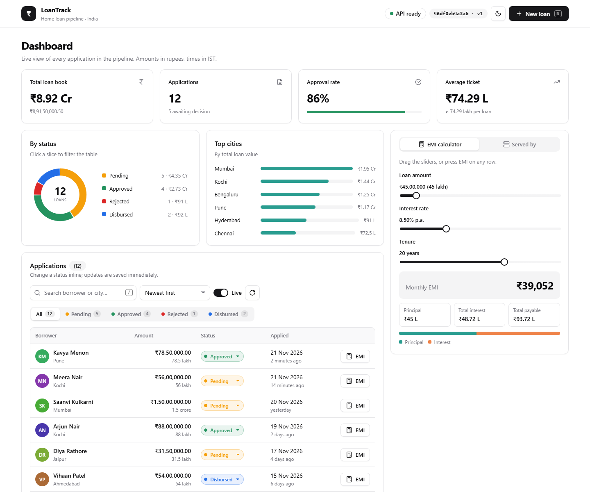
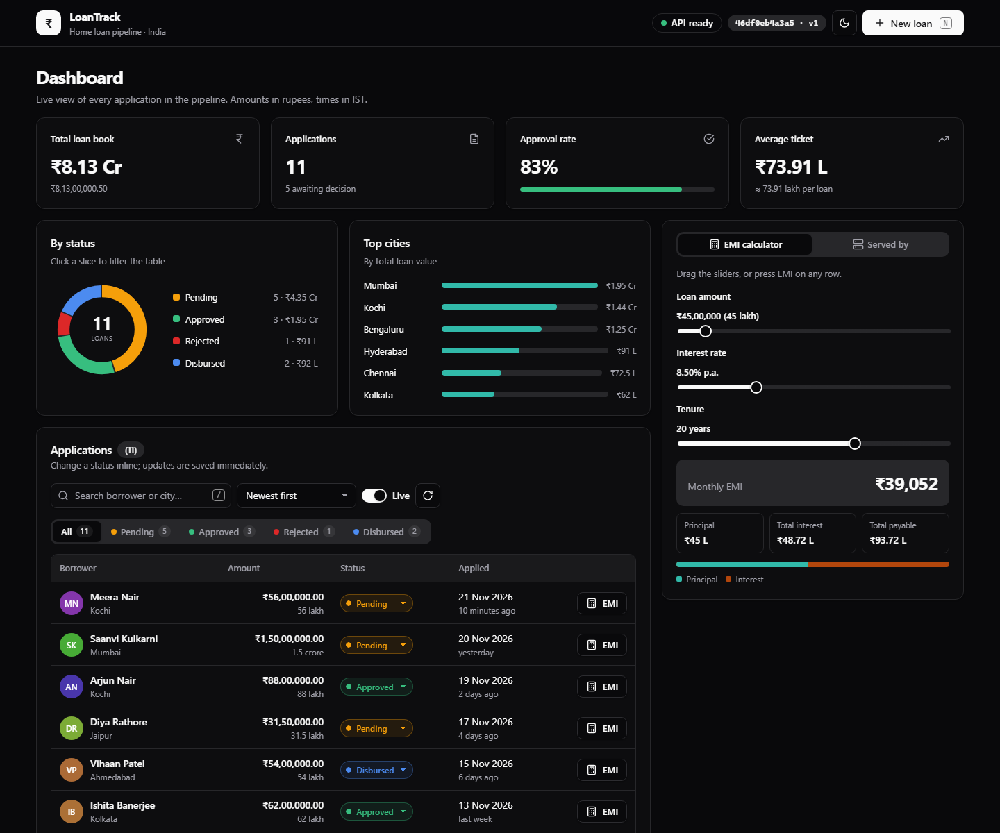
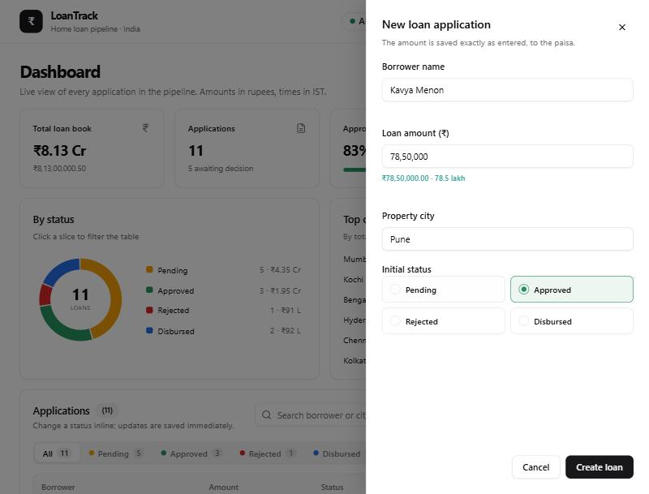
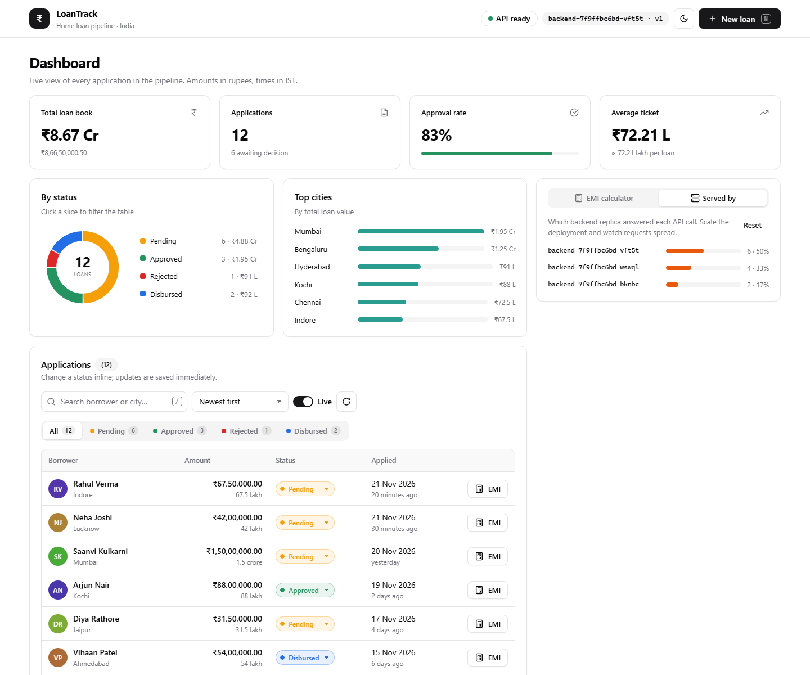
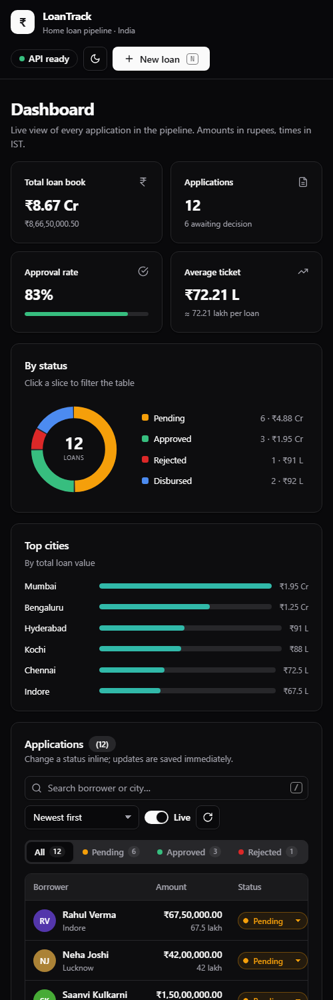

# Evidence

Everything below was produced by real runs on this machine (Windows 11 + WSL2 Ubuntu 24.04,
Docker Engine 29.1.3, minikube v1.39.0 / Kubernetes v1.37.0) on 21 Nov 2026.
The full, unedited terminal output is in:

- [docs/evidence/compose-run.txt](docs/evidence/compose-run.txt) - Parts B and C
- [docs/evidence/kubernetes-run.txt](docs/evidence/kubernetes-run.txt) - Part D

Excerpts are copied from those files; nothing was retyped.

## Backend tests and lint

```
$ ruff check . && ruff format --check . && pytest -q
All checks passed!
9 files already formatted
20 passed, 1 warning in 0.31s
```

## B1 - images, size, non-root, healthcheck

```
$ docker images --format 'table {{.Repository}}\t{{.Tag}}\t{{.Size}}' | grep -E 'REPOSITORY|loantrack'
REPOSITORY                    TAG           SIZE
loantrack-frontend            v1            72.2MB
loantrack-backend             v2            245MB
loantrack-backend             v1            245MB

$ docker compose exec backend whoami
app

$ docker compose exec frontend whoami
nginx

$ docker inspect --format '{{.State.Health.Status}}' loantrack-backend-1
healthy
```

Layer cache - a rebuild where only a later layer changes reuses the `pip install` layer:

```
#10 [builder 4/4] RUN pip install -r /tmp/requirements.txt
#10 CACHED
#14 [runtime 5/5] COPY app ./app
```

## B2 - one network, service names, named volume

```
$ docker network inspect loantrack-net --format '{{range .Containers}}{{.Name}} {{.IPv4Address}}{{println}}{{end}}'
loantrack-backend-1 172.19.0.2/16
loantrack-frontend-1 172.19.0.3/16
loantrack-db-1 172.19.0.4/16

$ docker compose exec backend python -c "import socket; print(socket.gethostbyname('db'))"
172.19.0.4

$ docker volume ls | grep loantrack
local     loantrack-pgdata
```

The database publishes no host port: `timeout 2 bash -c '</dev/tcp/127.0.0.1/5432'` -> connection refused.

## C - backend started before the database

```
$ docker compose up -d --no-deps backend
$ curl -s -w ' [%{http_code}]\n' localhost:8080/api/readyz
{"status":"not ready","database":"unreachable","served_by":"61d6b3eaa729"} [503]
$ curl -s -w ' [%{http_code}]\n' localhost:8080/api/healthz
{"status":"ok","served_by":"61d6b3eaa729","version":"v1"} [200]
$ docker compose up -d --wait db
$ docker compose logs --no-log-prefix backend | grep loantrack
2026-11-21 06:13:51,355 INFO    loantrack.api: starting loantrack-backend v1 on 61d6b3eaa729
2026-11-21 06:13:51,421 WARNING loantrack.db: database not reachable at db:5432 (attempt 1): [Errno -2] Name or service not known - retrying in 0.9s
2026-11-21 06:13:52,363 WARNING loantrack.db: database not reachable at db:5432 (attempt 2): [Errno -2] Name or service not known - retrying in 1.9s
2026-11-21 06:13:54,360 WARNING loantrack.db: database not reachable at db:5432 (attempt 3): [Errno -2] Name or service not known - retrying in 4.0s
2026-11-21 06:13:58,354 INFO    loantrack.db: database connection pool ready after 4 attempt(s)
$ curl -s -w ' [%{http_code}]\n' localhost:8080/api/readyz
{"status":"ready","database":"reachable","served_by":"61d6b3eaa729"} [200]
```

## C - row added in the UI, read back with psql

```
$ docker compose exec db sh -c 'psql -U "$POSTGRES_USER" -d "$POSTGRES_DB" -c "SELECT ... WHERE borrower_name = '\''Meera Nair'\''"'
 id | borrower_name | loan_amount | property_city | status
----+---------------+-------------+---------------+---------
 11 | Meera Nair    |  5600000.00 | Kochi         | PENDING
```

## C - persistence

```
count before `docker compose down`: 11
count after  `docker compose up -d --wait`: 11
```

`docker compose down -v` removed the `loantrack-pgdata` volume, so on the next `up` Postgres
initialised an empty data directory and re-ran the init scripts: **10 seed rows, the UI-added loan
was gone**.

```
 Volume loantrack-pgdata  Removed
10 rows, Meera Nair present: false
```

## D3 - DNS from a backend pod

```
$ kubectl -n loantrack exec deploy/backend -- python -c "import socket; print(socket.getfqdn('postgres')); print(socket.gethostbyname('postgres.loantrack.svc.cluster.local'))"
postgres.loantrack.svc.cluster.local
10.104.101.70

$ kubectl -n loantrack exec deploy/backend -- python -c "import socket; s=socket.create_connection(('postgres.loantrack.svc.cluster.local',5432),3); print('connected to', s.getpeername())"
connected to ('10.104.101.70', 5432)
```

Fully-qualified name: `postgres.loantrack.svc.cluster.local` (`<service>.<namespace>.svc.cluster.local`).
The Python image has no `nslookup`/`dig`, so the resolver is exercised through Python's socket module.

## D4 - scale to 3, requests served by every replica

```
$ kubectl -n loantrack scale deployment/backend --replicas=3
deployment.apps/backend scaled
$ kubectl -n loantrack get pods -l app.kubernetes.io/name=backend
NAME                      READY   STATUS    RESTARTS      AGE
backend-d68c55bc9-29ntz   1/1     Running   1 (49s ago)   2m19s
backend-d68c55bc9-k5f62   1/1     Running   1 (49s ago)   2m23s
backend-d68c55bc9-p2pkp   1/1     Running   1 (49s ago)   2m14s

# 12 requests through the NodePort, grouped by the pod that answered
      4 backend-d68c55bc9-29ntz v1
      4 backend-d68c55bc9-k5f62 v1
      4 backend-d68c55bc9-p2pkp v1
```

(The restart count of 1 comes from the minikube node restarting earlier, see ISSUES.md #3.)

## D4 - rolling update to v2 and rollback

```
$ kubectl -n loantrack set image deployment/backend backend=loantrack-backend:v2
$ kubectl -n loantrack rollout status deployment/backend --timeout=180s
Waiting for deployment "backend" rollout to finish: 1 out of 3 new replicas have been updated...
Waiting for deployment "backend" rollout to finish: 2 out of 3 new replicas have been updated...
Waiting for deployment "backend" rollout to finish: 1 old replicas are pending termination...
deployment "backend" successfully rolled out
$ kubectl -n loantrack rollout undo deployment/backend
deployment.apps/backend rolled back
$ kubectl -n loantrack rollout status deployment/backend --timeout=180s
deployment "backend" successfully rolled out
```

Mid-rollout, a user sees no errors: `maxUnavailable: 0` keeps three Ready pods at all times and
`maxSurge: 1` adds one new pod at a time, so for a short window some requests are answered by v1
and some by v2 (the version is in every response). The 5 s `preStop` sleep lets a terminating
pod finish in-flight requests after it is removed from the Service.

## D4 - delete a backend pod

```
$ kubectl -n loantrack delete pod backend-7f9ffbc6bd-gnhjz
pod "backend-7f9ffbc6bd-gnhjz" deleted from loantrack namespace
$ kubectl -n loantrack get pods -l app.kubernetes.io/name=backend
NAME                       READY   STATUS    RESTARTS   AGE
backend-7f9ffbc6bd-q8tnb   1/1     Running   0          26s
backend-7f9ffbc6bd-vft5t   1/1     Running   0          6s
backend-7f9ffbc6bd-wswql   1/1     Running   0          18s
```

## D4 - delete the PostgreSQL pod, rows survive

```
rows before: 11
$ kubectl -n loantrack delete pod postgres-0
$ kubectl -n loantrack wait --for=condition=Ready pod/postgres-0 --timeout=180s
pod/postgres-0 condition met
rows after: 11
$ kubectl -n loantrack get pvc
NAME              STATUS   VOLUME                                     CAPACITY   ACCESS MODES   STORAGECLASS
data-postgres-0   Bound    pvc-5c7cb56f-7db7-4613-88e9-05f891eadf50   1Gi        RWO            standard
```

## D4 - inventory

See the end of [kubernetes-run.txt](docs/evidence/kubernetes-run.txt) for
`kubectl get all -n loantrack` and `kubectl get pvc,configmap,secret -n loantrack`
(Services `backend`/`postgres`/`postgres-headless` are ClusterIP, `frontend` is NodePort 80:30080).

## Screenshots

| | |
|---|---|
| Docker Compose, light |  |
| Docker Compose, dark |  |
| New-loan sheet |  |
| Kubernetes, 3 backend replicas sharing traffic |  |
| Kubernetes, narrow screen, dark |  |
