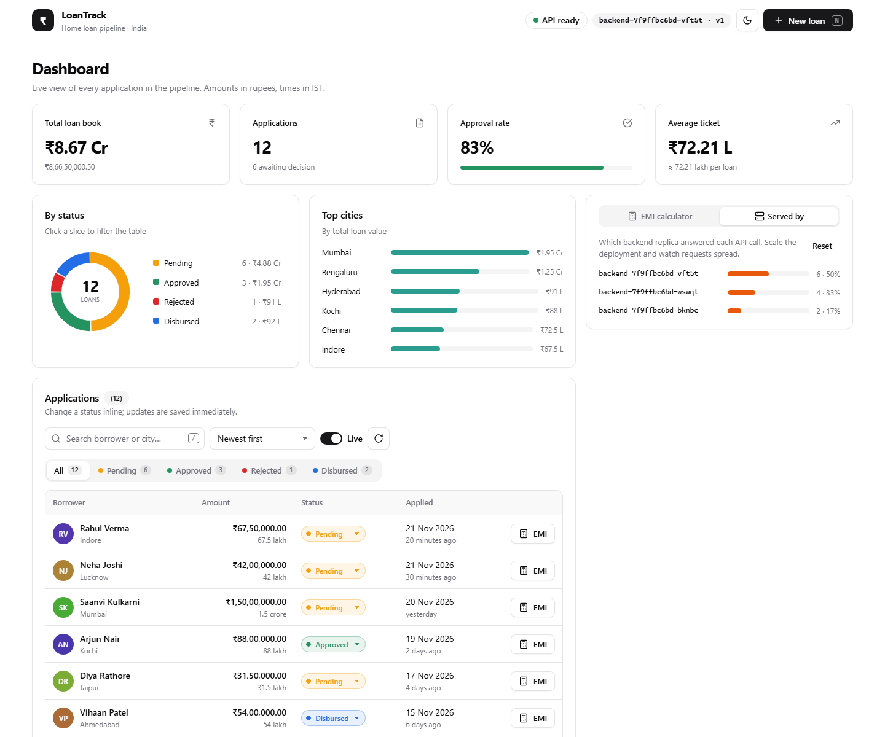
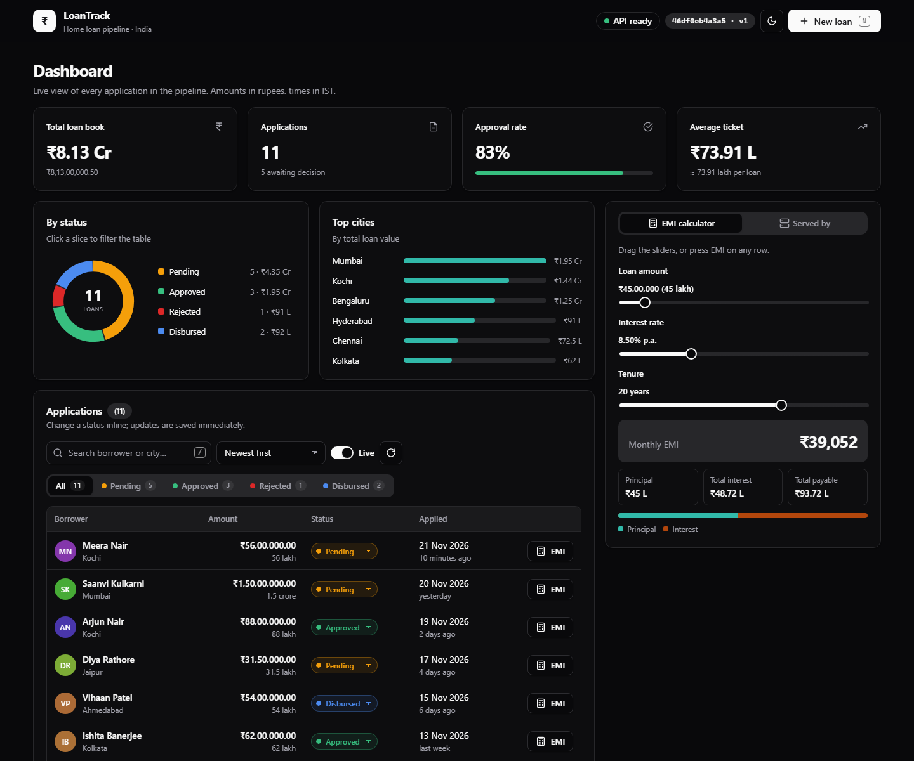
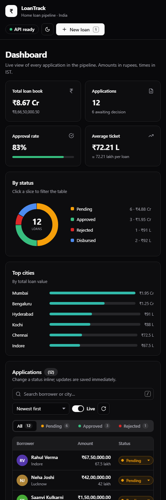
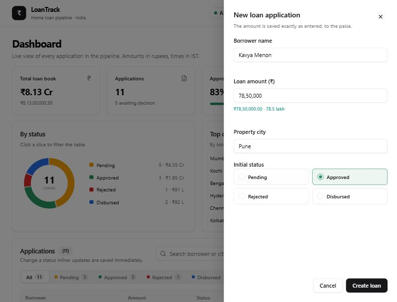

# LoanTrack

A three-tier home-loan tracker (browser → nginx frontend → FastAPI backend → PostgreSQL), packaged
with Docker Compose and deployed to a local Kubernetes cluster (minikube). Borrowers, cities and
amounts are Indian; money is shown in rupees with Indian digit grouping (₹1,50,00,000.00 · 1.5 crore).

The application code is deliberately small. The point of the repo is how the system is packaged,
wired, configured, deployed, operated and documented.



| Dark mode (Compose) | Narrow screen (Kubernetes) | New-loan drawer |
|---|---|---|
|  |  |  |

## Contents

- [Tool versions](#tool-versions)
- [Architecture](#architecture)
- [Run with Docker Compose](#run-with-docker-compose)
- [Run on Kubernetes (minikube)](#run-on-kubernetes-minikube)
- [Design decisions](#design-decisions)
- [Assumptions](#assumptions)
- [Repository layout](#repository-layout)
- Evidence: [EVIDENCE.md](EVIDENCE.md) · Problems hit: [ISSUES.md](ISSUES.md) · Branching: [BRANCHING.md](BRANCHING.md)

## Tool versions

| Tool | Version |
|---|---|
| OS | Windows 11 + WSL2, Ubuntu 24.04.5 LTS |
| Docker Engine (inside WSL) | 29.1.3 |
| Docker Compose | 2.40.3 |
| minikube | v1.39.0 (docker driver, containerd runtime) |
| Kubernetes (cluster) | v1.37.0 |
| kubectl | v1.37.2 |
| Backend runtime | Python 3.12.8 (`python:3.12.8-slim-bookworm`), FastAPI 0.115.6, psycopg 3.2.3 |
| Frontend runtime | `nginxinc/nginx-unprivileged:1.27.3-alpine` |
| Database | `postgres:16.6-alpine` |

## Architecture

```
                         Docker Compose: host :8080 -> frontend :8080
                         Kubernetes:     NodePort :30080 -> Service frontend :80 -> pod :8080
                                                  │
 ┌─────────┐   HTTP    ┌──────────────────────────▼───────┐
 │ Browser │ ────────► │ frontend  (nginx, uid 101)       │   static index.html / app.js / styles.css
 └─────────┘  /, /api  │   /api/*  ──proxy──┐              │   /healthz answered by nginx itself
                       └────────────────────┼──────────────┘
                                            │ HTTP :8000   (Compose: http://backend:8000,
                                            ▼               K8s: backend.loantrack.svc.cluster.local:8000)
                       ┌──────────────────────────────────┐
                       │ backend  (FastAPI, uid 10001)     │   GET/POST /loans  PATCH /loans/{id}
                       │ x2-3 replicas on Kubernetes       │   GET /stats  /healthz  /readyz
                       │ psycopg connection pool (1-5)     │
                       └────────────────────┬─────────────┘
                                            │ PostgreSQL :5432   (Compose: db, K8s: postgres)
                                            ▼
                       ┌──────────────────────────────────┐
                       │ postgres 16  (uid 70)             │   Compose: named volume loantrack-pgdata
                       │ schema + seed applied on first    │   K8s: StatefulSet postgres-0 + PVC
                       │ start from db/migrations, db/seed │        data-postgres-0 (1Gi)
                       └──────────────────────────────────┘

Traffic only flows downwards. The browser never sees a database address or credential; the
database has no host port (Compose) and only a ClusterIP Service (Kubernetes).
```

## Run with Docker Compose

Prerequisites: Docker Engine + Compose v2.

```bash
git clone https://github.com/omghewade/loantrack.git && cd loantrack
cp .env.example .env            # then change POSTGRES_PASSWORD
docker compose up -d            # first run builds both images
# open http://localhost:8080
```

Useful commands:

```bash
docker compose ps                                   # all three should be (healthy)
docker compose logs -f backend                      # API logs, including DB retry attempts
docker compose exec db sh -c 'psql -U "$POSTGRES_USER" -d "$POSTGRES_DB" -c "SELECT * FROM loans"'
docker compose down                                 # stop, keep data
docker compose down -v                              # stop and DELETE the database volume
```

`POSTGRES_*` values are only read when the volume is first created. After changing them in `.env`,
run `docker compose down -v` (this deletes local data) so Postgres initialises again.

## Run on Kubernetes (minikube)

Prerequisites: minikube, kubectl, Docker (the deploy script builds images locally and loads them
into the cluster).

```bash
cp .env.example .env            # if not done already; the Secret is created from it
./scripts/deploy.sh             # or: make deploy
```

The script is idempotent: it starts minikube if needed, builds and loads `loantrack-backend:v1` and
`loantrack-frontend:v1`, creates the namespace, ConfigMap, Secret (from `.env`) and the `db-init`
ConfigMap (from `db/`), deploys Postgres and waits for it, deploys backend and frontend, waits for
both rollouts and prints the URL. Re-running it with nothing changed rolls nothing.

Open the app:

```bash
minikube service frontend -n loantrack --url              # prints http://192.168.49.2:30080
# Windows browser, with minikube running inside WSL (the minikube IP is not reachable from Windows):
kubectl -n loantrack port-forward svc/frontend 8081:80    # then http://localhost:8081
```

Operating it:

```bash
make status                                                # get all + pvc/configmap/secret
kubectl -n loantrack scale deployment/backend --replicas=3
make rollout-v2                                            # build :v2 and roll it out
make rollback                                              # kubectl rollout undo deployment/backend
kubectl -n loantrack delete pod postgres-0                 # data survives on the PVC
```

The Secret is never committed. [k8s/secret.example.yaml](k8s/secret.example.yaml) shows its shape
with dummy values and the command to create the real one by hand.

## Design decisions

- **Backend base image** - `python:3.12.8-slim-bookworm`: glibc-based, so psycopg's binary wheel
  works without compiling, and small enough (backend image 245 MB, limit 300 MB). Alpine would be
  smaller but needs musl wheels or a compiler for some dependencies.
- **Layer-cache boundary** - `requirements.txt` is copied and installed in the builder stage
  before any application code. A code-only change rebuilds just the final `COPY app ./app` layer;
  the `pip install` layer comes from cache ([evidence](docs/evidence/compose-run.txt)).
- **Postgres: StatefulSet, not Deployment + PVC** - a stable pod identity (`postgres-0`), a PVC
  created per replica from `volumeClaimTemplates` and re-attached to the same identity, and ordered
  start/stop. With one replica a Deployment + PVC would also work, but a Deployment can briefly run
  two pods against one RWO volume during a rollout.
- **Liveness vs readiness** - liveness (`/healthz`) asks "is the process stuck?" and never touches
  the database; readiness (`/readyz`) asks "can this pod serve now?" and checks the pool. A
  database outage therefore removes backend pods from the Service instead of restarting all of
  them. A startup probe gives the process 30 s before liveness applies.
- **Probe timings** - readiness every 5 s, 2 failures (pulled from traffic within ~10 s);
  liveness every 10 s, 3 failures (restarted only after ~30 s of no answer, so a GC pause or a
  slow request does not kill it). Postgres liveness starts at 30 s because the first start runs
  `initdb` and the seed.
- **Memory limit vs CPU limit** - exceeding the memory limit gets the container OOM-killed and
  restarted (`OOMKilled`, restart count goes up); exceeding the CPU limit only throttles it - it
  runs slower but is not killed.
- **Secrets** - base64 in a Secret is encoding, not encryption: anyone who can `get secret` can
  decode it. In production: etcd encryption at rest, tight RBAC, and the values kept in an external
  store (e.g. GCP Secret Manager through External Secrets Operator), or Sealed Secrets for GitOps.
- **Rolling updates** - `maxSurge: 1, maxUnavailable: 0`: a new pod must be Ready before an old one
  is removed, and a 5 s `preStop` sleep lets the endpoint removal propagate. A user mid-rollout sees
  no errors; for a short window some requests are answered by v1 and some by v2.
- **nginx resolves the backend per request** - with a literal hostname nginx resolves once at
  startup and exits if DNS is not ready (this crash-looped the frontend after a cluster restart,
  see [ISSUES.md](ISSUES.md)). A `resolver` plus a variable in `proxy_pass` defers the lookup.
- **Connection pooling and startup retry** - one psycopg pool per process (1-5 connections). A
  background thread retries the first connection with capped exponential backoff (1 s, 2 s, 4 s...
  max 30 s, ±20% jitter) and logs every attempt; the API starts immediately and `/readyz` stays 503
  until the pool is ready.
- **Money** - `NUMERIC(14,2)` in Postgres, `Decimal` in Python and a string in JSON, so amounts
  never pass through floating point. The UI formats with `Intl.NumberFormat('en-IN')` and shows
  lakh/crore in words.
- **Frontend without a framework** - one static page and plain JavaScript, served by unprivileged
  nginx. The look follows shadcn/ui (zinc tokens, Card, Badge, Tabs, Sheet, Sonner-style toasts)
  but is re-implemented in plain CSS, so there is no Node build, no Tailwind and no CDN - it works
  on an offline cluster. Data is rendered with `textContent` only (no `innerHTML`), and a strict
  Content-Security-Policy is set.
- **UI extras** - live search, status tabs with a sliding indicator and arrow-key navigation, inline
  status changes, KPI count-up tiles, status donut and city bars, an EMI calculator, a "Served by"
  panel showing which backend pod answered each call (`/#served-by`), auto-refresh, dark mode,
  keyboard shortcuts (`/` search, `N` new loan, `R` refresh, `T` theme).

## Assumptions

- "Backend image under 300 MB" is measured with `docker images` on the local engine (245 MB).
- minikube runs inside WSL2 with the docker driver; the NodePort is reached from Windows through
  `kubectl port-forward`.
- Status values are fixed to `PENDING`, `APPROVED`, `REJECTED`, `DISBURSED` (enforced in both the
  API and a database `CHECK` constraint).
- Times are stored in UTC and shown in IST (`Asia/Kolkata`).

## Repository layout

```
backend/            FastAPI app, tests, multi-stage Dockerfile
frontend/           static UI (src/), nginx template, multi-stage Dockerfile
db/migrations/      001_create_loans.sql   - schema
db/seed/            002_seed_loans.sql     - 10 demo loans
k8s/                namespace, configmap, secret.example, postgres, backend, frontend
scripts/deploy.sh   one-command, idempotent minikube deploy
docs/evidence/      raw command output from real runs
docs/screenshots/   UI under Compose and Kubernetes
```
